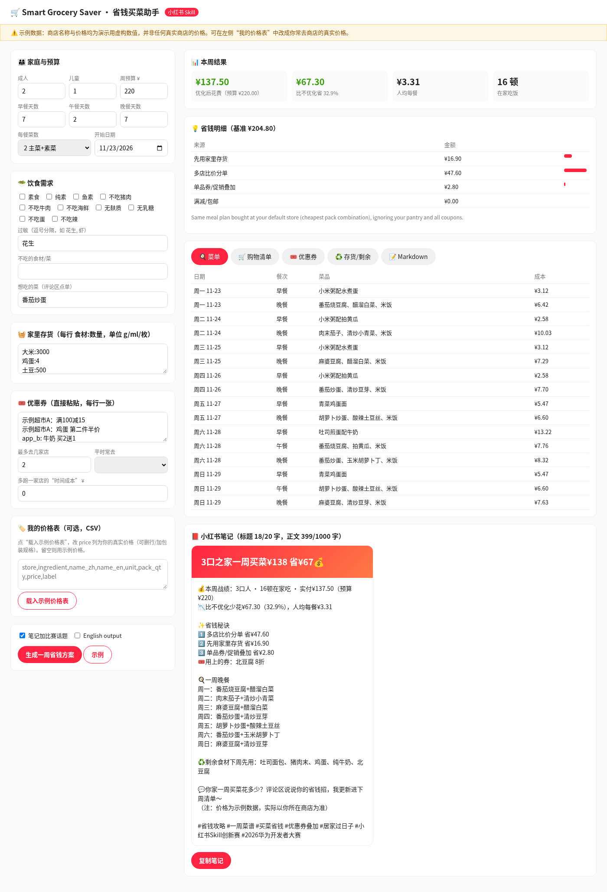
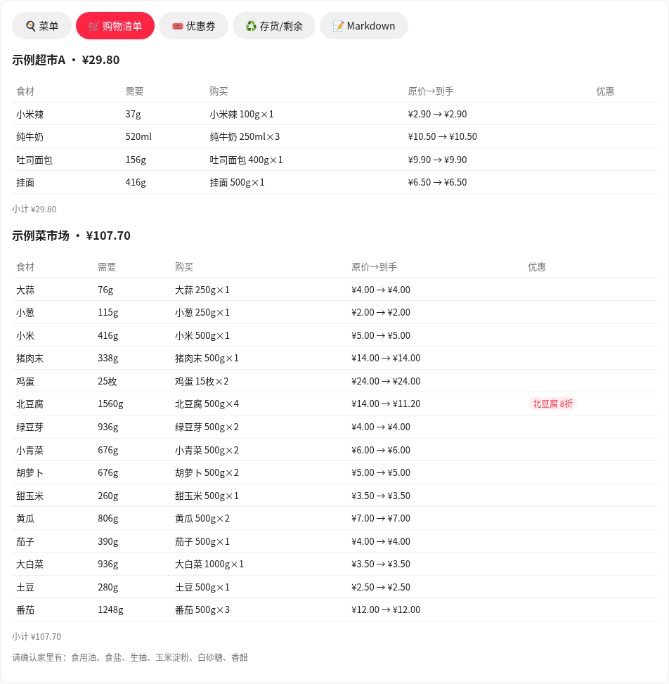

# Smart Grocery Saver · 省钱买菜助手

A reusable **Skill** for the **2026华为开发者大赛·小红书Skill创新赛** (2026 Huawei Developer Competition —
Xiaohongshu Skill Innovation track).

Tell it your household size, weekly budget, dietary needs, what is already in the fridge and the coupons you
have. It returns:

1. **a weekly meal plan** (breakfast / lunch / dinner, diet- and allergy-safe, varied, uses up pantry stock),
2. **an optimised shopping list split by store** (cheapest pack sizes, at most N stores, delivery fees),
3. **coupon-stacking savings** (满减, 折扣, 买赠, 第二件半价, 立减; including which coupons were not worth using and why),
4. **a ready-to-post Xiaohongshu (小红书) note** (title ≤ 20 chars, body ≤ 1000 chars, hashtags).

> ⚠️ **Sample data.** The bundled stores (示例超市A, 示例菜市场, 示例买菜App B) and their prices are **fictional,
> illustrative values**, not real or current prices from any real shop. Every output says so. Replace them with
> your own prices via a CSV (`export-prices` → edit → `--prices`) or `price_overrides` in the request.



## Why this scenario

Weekly grocery shopping is a real, recurring household task, and it matches the track's “learn → do → share”
(学—做—晒) loop:
- **learn**: read someone's 省钱买菜 note,
- **do**: run the Skill with your own household, pantry and coupons,
- **share**: post the generated note; comments (“想看可乐鸡翅”, “孩子不吃茄子”) go back in as `favorites` /
  `dislikes`, and this week's leftovers become next week's pantry.

The official page lists “菜谱搭配Skill：输入现有食材，自动推荐菜谱并生成采购清单” as an example under 赛题二
“AI生活达人”. This Skill goes further, adding budget, coupon and multi-store optimisation. I kept the
recommended scenario because no other candidate had clearly stronger user value or demo value.
Suggested sub-track: **通用赛道 → 生活方式** (or 产业赛道 → 本地生活). Which one to pick is your decision.

## Repository layout

```
skills/smart-grocery-saver/        ← the Skill package (this folder is what gets uploaded; 18 files)
  SKILL.md                         ← Skill definition: triggers, workflow, guardrails (YAML front matter)
  skill.json                       ← machine-readable manifest: commands, input/output contract, exit codes
  schemas/input.schema.json        ← request JSON Schema
  scripts/grocery_saver.py         ← CLI: plan | parse-coupons | export-prices | validate
  scripts/saver/                   ← engine (pure Python stdlib, 3.9+, no network)
    data.py      validation, catalog, aliases, pantry parsing, price overrides
    coupons.py   coupon model, Chinese/English coupon-text parser, stacking math
    shopping.py  pack-size + coupon + multi-store basket optimiser
    planner.py   meal-plan search (cost + variety + diet + pantry)
    engine.py    orchestration, savings breakdown, leftovers, warnings
    report.py    Markdown report + Xiaohongshu note
  data/sample_catalog.json         ← SAMPLE stores / 42 ingredients / 124 pack prices (editable)
  data/recipes.json                ← 39 home-style recipes with per-portion quantities and tags
  examples/*.json                  ← 3 example requests
  examples/output/<example>/       ← generated plan.json / plan.md / xiaohongshu_note.txt
  references/                      ← optimisation and coupon-rule details
demo/server.py, demo/index.html    ← local web UI (stdlib http.server, no build step)
tests/                             ← 46 unittest tests (engine, coupons, CLI, HTTP API)
tools/package_skill.py             ← builds dist/smart-grocery-saver-<ver>.zip and checks the 30-file / 40 MB limits
.github/workflows/ci.yml           ← runs tests on Python 3.9 / 3.11 / 3.13
```

## Architecture

```
request JSON ──► data.normalize_input ──► planner.Planner.solve ──► engine._price ──► report
 (household,      validate schema,         recipes filtered by        shopping.Shopper:      Markdown +
  budget, diet,   aliases (中/EN),          diet/allergy tags; local   pack combos × coupon   小红书 note
  pantry,         pantry "鸡蛋:6",          search minimising cost +   sets × store subsets;
  coupons…)       coupon text → struct      variety penalties          local search across
                                                                        stores (满减, delivery)
```

- **Meal planning**: greedy start + local search over recipe slots. The objective is marginal ingredient cost after
  pantry, plus penalties for repeated dishes, the same protein too often and too few meat/fish mains (when the diet
  allows them), minus a bonus for favourites. Shared ingredients lower marginal cost, which reduces waste. If the
  balanced plan is over budget, a cheaper “budget mode” plan is tried automatically.
- **Shopping**: for each ingredient × store it tries every pack-count combination, including an extra pack to
  unlock buy-x-get-y, with every allowed coupon set. It then picks the best store subset (≤ `max_stores`, with an
  optional time cost per extra store) and moves items between stores when consolidating them reaches a 满减
  threshold or free delivery.
- **Savings breakdown** against a baseline (same meals at your usual store, no pantry, no coupons): pantry →
  store comparison → item coupons → order coupons/delivery. The steps add up exactly to `baseline − total`
  (checked by a test).
- The optimiser is deterministic and heuristic (local search, not an exact solver). It runs in under 0.1 s.

Details: [`references/optimization.md`](skills/smart-grocery-saver/references/optimization.md),
[`references/coupon-rules.md`](skills/smart-grocery-saver/references/coupon-rules.md).

## Run it

Requires Python ≥ 3.9 and nothing else.

```bash
git clone https://github.com/ZQ051031/huawei-xiaohongshu-skill-2026.git
cd huawei-xiaohongshu-skill-2026
S=skills/smart-grocery-saver

# 1) CLI — Markdown report
python3 $S/scripts/grocery_saver.py plan -i $S/examples/family_of_three.json -f markdown

# write plan.json + plan.md + xiaohongshu_note.txt
python3 $S/scripts/grocery_saver.py plan -i $S/examples/family_of_three.json -o out/

# stdin, just the 小红书 note
echo '{"household":{"adults":2},"budget":{"weekly":150},"pantry":["鸡蛋:6"],"coupon_texts":["满59减8"]}' \
  | python3 $S/scripts/grocery_saver.py plan -f note

# use YOUR prices
python3 $S/scripts/grocery_saver.py export-prices > my_prices.csv   # edit the price column / add rows
python3 $S/scripts/grocery_saver.py plan -i $S/examples/family_of_three.json --prices my_prices.csv

# check how pasted coupons are understood
python3 $S/scripts/grocery_saver.py parse-coupons "示例超市A：满100减15" "牛奶 买2送1" "第二件半价 鸡蛋"

# 2) Web demo → http://127.0.0.1:8765
python3 demo/server.py

# 3) Tests and packaging
python3 -m unittest discover -s tests -v
python3 tools/package_skill.py        # → dist/smart-grocery-saver-1.0.0.zip
```

Exit codes: `0` ok · `2` invalid input (every problem is listed on stderr) · `3` over budget with `--strict-budget`.

## Example

Input ([`examples/family_of_three.json`](skills/smart-grocery-saver/examples/family_of_three.json)):

```json
{
  "household": {"adults": 2, "children": 1},
  "budget": {"weekly": 220},
  "meals": {"breakfast": 7, "lunch": 2, "dinner": 7},
  "diet": {"allergies": ["花生"], "dislikes": ["香菜"], "favorites": ["番茄炒蛋"]},
  "pantry": ["大米:3000", "鸡蛋:4", "土豆:500"],
  "coupon_texts": ["示例超市A：满100减15", "示例超市A：鸡蛋 第二件半价", "app_b: 牛奶 买2送1", "wet_market: 豆腐 8折"],
  "stores": {"max_stores": 2, "default_store": "market_a"},
  "start_date": "2026-11-23",
  "output": {"lang": "zh", "include_contest_tags": true}
}
```

Output summary (sample prices): **¥137.50 spent of a ¥220 budget**, against an unoptimised baseline of ¥204.80, so
**¥67.30 (32.9%) saved**, ¥3.31 per portion, 16 home meals, 2 stores. Savings breakdown: store comparison ¥47.60,
pantry ¥16.90, tofu 20% off ¥2.80. Unused coupons come with reasons, e.g. “满100减15 (订单小计¥29.80未达门槛¥100，凑单不划算)”.

Full outputs: [`plan.md`](skills/smart-grocery-saver/examples/output/family_of_three/plan.md),
[`plan.json`](skills/smart-grocery-saver/examples/output/family_of_three/plan.json),
[`xiaohongshu_note.txt`](skills/smart-grocery-saver/examples/output/family_of_three/xiaohongshu_note.txt).
Shopping list view in the web demo:



| Example | Household / budget | Result (sample prices) |
|---|---|---|
| `family_of_three.json` | 2 adults + 1 child, ¥220, peanut allergy | ¥137.50, saved ¥67.30 (32.9%) |
| `vegetarian_couple_en.json` | 2 adults, ¥150, vegetarian + no spicy, English | ¥98.78, saved ¥31.62 (24.2%) |
| `student_tight_budget.json` | 1 adult, ¥60, no beef, 1 store | ¥42.50, saved ¥43.20 (50.4%) |

## Official rules: what the page confirmed

Source: <https://developer.huaweicloud.com/competition/information/1300000350/html3>. The page body showed
“数据开小差，请稍后再试”, but the page's own public JSON data (the same requests the page makes, read without
logging in) returned the full tab contents. Read on 2026-11-22.

| Topic | Confirmed on the official page |
|---|---|
| Organisers | “由华为与小红书科技联合主办” |
| Prize pool | ¥500,000 (`bonus: 500000`) |
| Deadline | Registration and submission end `2026-11-29 15:59:59` (API timestamp; the time zone is not stated, likely UTC = 23:59:59 Beijing time). The schedule says “即日起-2026年11月29日” |
| Eligibility | Organisations, companies or individuals with software development ability, and students. **Companies must complete enterprise certification** |
| Team size | **Individual or a team of 2–5**; each person can join only one team; **every team member must register** (FAQ) |
| Registration | Log in to the competition site → “立即报名”; registration info cannot be changed freely afterwards |
| Hard requirement | The work **must use at least one of 华为云码道 CodeArts or 果办 OfficeAce** (other tools may be added) |
| Work requirements | Original; real scenario; runnable; reusable; multiple submissions allowed, latest one counts; multiple Skills per person/team allowed; the same work cannot win in several tracks |
| Submission route | Submit via **CodeArts** (web or IDE) or **OfficeAce** (Windows client ≥ V1.4.1) |
| Markets | “skill需要**同时发布到华为云skill市场和小红书skill市场**” (both markets are required) |
| Xiaohongshu note | Notes for the published Skill must carry **#小红书Skill创新赛 #2026华为开发者大赛** (at least one note) |
| Limits | Total size of all Skill files per submission ≤ **40 MB**; ≤ **30 files** |
| Sub-tracks | 产业赛道 (内容电商, 智能制造, 智慧农业, 教育科技, 文旅服务, 医疗健康, 本地生活) or 通用赛道 (效率工具, 内容创作, 学习成长, 生活方式, 开发工具) |
| Judging | Five criteria: 场景真实性、作品可用性、Skill 复用率、技术完成度、内容传播力 |
| Real-name / main account | The ¥200 cloud-voucher section says: “申领条件：完成大赛报名（**需要实名认证，且使用华为云主账号，子账号无法领取**）” |

Prize table (national final, Top32 + campus champions):

| Award | Count | Prize |
|---|---|---|
| 金奖 | 1 | ¥100,000 + certificate |
| 银奖 | 2 | ¥50,000 + certificate |
| 铜奖 | 3 | ¥20,000 + certificate |
| 最佳Skill创新奖 | 10 (码道全开×5 + 果力全开×5) | ¥10,000 + certificate |
| 单项奖 | 5 | ¥5,000 + certificate |
| 优秀奖 | 115 | gift worth ¥1,000 + certificate |

All prizes are pre-tax. Prizes for multi-person teams are paid to the team captain.

### Not confirmed, or inconsistent on the page

- **Real-name main account for registration/submission**: there is no standalone rule. The only wording is the
  voucher condition above, which reads as “registration (requires real-name verification and a Huawei Cloud main
  account)”. Plan on using a **real-name-verified Huawei Cloud main account**, not a sub-account.
- **Review dates disagree**: the schedule table says preliminary review 11-30 → 12-02, joint review 12-03 → 12-06,
  finalists announced 12-07, final 12-19 → 12-20. The “评审与晋级” section says 11.25–11.27, 11.30–12.3 and
  12.11–13.
- The Xiaohongshu Skill Market's own packaging format and metadata fields are not documented on the page.
  The page only says to upload the packaged zip on the Skill Hub page and fill in the work info.
- The time zone of the deadline timestamp.

## How to submit (user-only steps)

I did **not** register, log in, verify identity, publish to any market or submit anything. These steps are yours:

1. Register on the competition page (“立即报名”). Every team member registers. Companies complete enterprise
   certification. Complete Huawei Cloud real-name verification if the flow asks for it.
2. **Use CodeArts or OfficeAce (hard requirement).** For example, open 码道 CodeArts (web or IDE), import this repo or the
   `skills/smart-grocery-saver/` folder, and iterate or validate with it so the work is developed with CodeArts.
3. Package: `python3 tools/package_skill.py` → `dist/smart-grocery-saver-1.0.0.zip` (18 files, about 46 KB, within the limits).
4. Publish to **both markets**:
   - CodeArts: tell it “我正在参加小红书Skill创新赛，帮我把这个Skill先发布到华为云Skill市场，再使用redskillhub-upload发布到小红书Skill市场” and confirm each prompt; or
   - OfficeAce: “我正在参加小红书Skill创新赛，帮我把这个Skill发布到华为云Skill市场和小红书Skill市场”, then upload the zip on the
     Xiaohongshu Skill Hub page it links to.
5. Post at least one Xiaohongshu note about the published Skill with **#小红书Skill创新赛 #2026华为开发者大赛**.
   The Skill writes this note for you: set `"output": {"include_contest_tags": true}`. Replace the sample prices with real
   ones first, or keep the sample-data line.
6. Optional: a demo video and the finals presentation (not created here).
7. Before the deadline, make sure the latest version is published in both markets (the latest submission counts).

## Limitations

- Bundled prices and stores are samples. Real-time price lookup is intentionally not included (no network, no scraping).
- Allergy and diet filtering depends on recipe and ingredient tags. People with severe allergies should still check labels.
- Coupon stacking follows common Chinese grocery-app rules (see references). A specific shop's terms may differ:
  mark coupons `stackable: false` / `excludes_discounted: true` as needed.
- Recipe quantities are home-cooking estimates per adult portion.

## License

MIT
